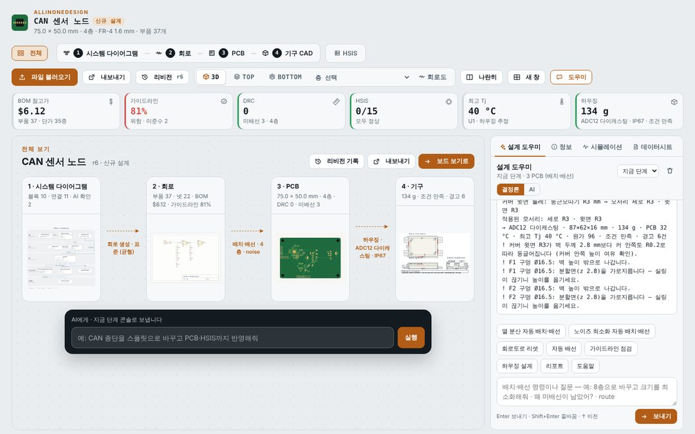

# AllinOneDesign

**요구사항 한 줄에서 시스템 다이어그램 → 회로 → PCB → 기구(하우징)까지, 브라우저 하나에서 AI와 함께 설계하는 단일 HTML 도구**입니다. 파일은 브라우저 안에서만 처리되며 서버로 전송되지 않습니다.

- 실행: `dist/index.html`을 브라우저로 엽니다 (3D·zip·엑셀 라이브러리만 CDN에서 불러오므로 인터넷 연결 필요).
- 사용 설명서: [docs/manual.html](docs/manual.html) · 기능 상세 노트(버전별): [docs/DETAILS.md](docs/DETAILS.md)
- 예제: SENSE-32, MCU DC 모터(MOTION-32 DEV), MCU BLDC 3상(MOTION-32 BLDC), AURIX TC364 인버터 — 첫 화면의 예제 칩으로 엽니다.



## 주요 기능

### 1. 단계별 설계 (신규 설계)
| 단계 | 하는 일 | 결과물 |
|---|---|---|
| **1 시스템 다이어그램** | 프로젝트 이름·요구사항을 적으면 AI가 분석하고, 빠진 필수 정보(전원·MCU·통신·기능·환경)는 **응답형 질문 카드**로 물어본 뒤 HW 블록 다이어그램을 그립니다. 블록·기능·인터페이스를 명령 또는 패널에서 편집합니다. | HW 블록 다이어그램 (SVG) |
| **2 회로** | 다이어그램을 **저가형 · 표준 · 확장형** 세 회로 안으로 풀어 BOM 참고가·부품 수·여유 MCU 핀·레귤레이터 손실·점수를 비교하고 하나를 고릅니다. 실제 부품 선정 · 넷리스트 · MCU 핀 배정 · 회로도가 만들어지며, **데이터시트 탭**에서 부품별 정리 페이지(HTML DB)를 봅니다. | 회로도(여러 시트) · 넷리스트 · BOM |
| **3 PCB** | 층 수(2–10) · 보드 크기(최소화/자동/직접) · 배치 전략을 고르면 자동 배치·배선합니다. 부품 끌어 옮기기·배선·비아·DRC·래츠네스트 편집, 내층을 포함한 **층별 보기**, 핀 스왑으로 회로와 함께 수정. | 배치·배선된 보드 (KiCad 저장) |
| **1 안전 목표** | ASIL ≠ QM이면 안전 목표(SG)를 고르고 위반 경로 블록에 태그, 구조 변형 3안(단일 MCU+외부 감시 · 메인+세이프티 MCU · ASIL 분해 2채널)을 DC·FTTI·원가로 비교해 적용, 규칙으로 검증(감지·독립 차단·FTTI·독립성·공통 원인). | SG 태그 · 검증 ✓/✗ |
| **4 기구 CAD** | 보드를 감싸는 보호 하우징을 Text-to-CAD로 설계합니다(시안 A 다이캐스팅·B 사출 스냅핏·C 압출 프로파일·D 하이브리드, 재질 6종·IP·진동·발열 조건, 구멍·글랜드·벤트·탭·리브·핀·각인, 둥근모따기/각모따기). 3D에서 요소를 **선택해 AI에게 지시**하고, 조립도·부품도(베이스/커버)·기구 BOM·SCAD/STL을 냅니다. | 하우징 3D · 도면 · BOM · SCAD |

기존 프로젝트(KiCad `.kicad_pcb`·회로도, Gerber, 뷰어 JSON)도 같은 단계 표시줄로 오갑니다. 1단계는 보드에서 추출한 HW 블록 다이어그램입니다.

### 2. AI 설계 도우미
- 오른쪽 도킹 패널의 **설계 도우미**가 네 단계의 콘솔(시스템·회로도·배치/배선·Text-to-CAD)을 하나의 대화로 합칩니다. 결정론 모드는 문장을 규칙으로 명령으로 바꾸고, AI 모드는 Claude가 같은 명령을 골라 실행합니다.
- 설계를 바꾼 실행마다 **변경 요청 카드**가 붙습니다: 시스템·회로·PCB·HSIS·기구·BOM 영향, 변경 요약, 실행한 명령. **승인**하면 `CR-n` 리비전으로 기록되고, **되돌리기**는 그 실행만 정확히 되돌립니다.
- 기구 CAD에서는 3D나 형상 트리에서 요소를 고른 뒤(Shift/Ctrl 다중) "이거 M20으로 키우고 윗면은 R2"처럼 지시합니다.
- **등급 부품 자동 적용**: ASIL 프로젝트는 회로 생성 때 상용 부품을 핀 호환 차량용(AEC-Q100/Q101/Q200) 부품으로 바꾸고, `safety parts [--apply]`가 등급 미달·미상 부품과 대체품을 점검·일괄 교체합니다. 부품 레코드에 등급·온도·ASIL·FIT 필드(CSV·Claude 추정·API).
- **기능 안전(ASIL)**: 요구사항의 ASIL A~D를 읽어 시스템·블록 등급(배지·세이프 스테이트 경로·FFI 경계)을 다이어그램에 얹고, 등급별 권장 안전 메커니즘(전원 감시·외부 워치독·fault 리드백·SBC·이중 차단·리던던트 센서·2채널)을 블록으로 추가해 회로 부품(TPS3823 감시/워치독, 하이사이드 차단 스위치)까지 생성합니다. 회로·PCB 콘솔 `safety check`/`safety fmeda`가 등급별 회로 점검과 FIT·DC·SPFM·PMHF 추정을 내고 보고서·Excel·HSIS에 실립니다.
- **회로 해석(analyze)**: 전원 트리 · 디커플링 감사 · RC/LC·분압·LED 패턴 · 수동 소자 AC 주파수 응답 · DC 동작점(MNA) · IR drop · 신호 무결성 · 열 · EMC를 조회 명령으로 열어, 질문 모드의 Claude가 "필터 컷오프 얼마야?", "레일 전압 강하는?"에 계산값으로 답합니다.
- **아무 부품이나 추가**: "CC2420 추가해줘" → 라이브러리/Claude 추정의 핀 배열로 심볼을 만들고 전원·접지 자동 연결, 나머지 핀은 `connect`로, `apply`로 보드에(패키지 이름으로 풋프린트 생성).
- **보드 모양**: 사각형 외에 라운드·원형·타원·L자·T자·육각·팔각·다각형과 컷아웃(구멍) — 시작 카드에서 고르거나 `board shape …`/"원형 60mm로".
- **제품 프로필**: "EPS ECU 설계"처럼 제품만 적어도 표준 블록 구성(전원·SBC·락스텝 MCU·CAN-FD·인버터·페이즈 컷·센서 IF…)을 먼저 깔고, 블록별로 갈리는 것(타입·센서 IF·리던던시…)만 묻습니다. AI 모드는 어떤 제품이든, 규칙 모드는 EPS·BMS·BCM·인버터 템플릿.
- **로컬 AI**: claude.ai 밖(내려받은 파일·`npm run serve`)에서는 [Claude 허용] → 로컬 AI 설정에 API 키(또는 프록시)를 넣으면 같은 AI 모드가 Messages API로 동작합니다. `npm run serve:copilot`이면 API 키 없이 **GitHub Copilot** 구독(Copilot CLI 로그인)으로 동작합니다.
- **회로 보강 명령**: "HSIS 기준으로 테스트 포인트 전부 달아줘"(`tp`), "안 쓰는 핀 10k로 GND에"(`tie`), "전원 입력에 페라이트 비드"(`insert`), `add C --pins U1.12,GND`처럼 핀을 직접 지정 — AI 모드가 이 명령들로 풀어 실행하고 보드에 반영(`apply`)까지 합니다. TP는 HSIS 표의 TP 열·검사에 연결됩니다.
- **부품 교체(대화형)**: "U2를 AP2112K-3.3으로 바꿔줘"라고 하면 승인 부품 목록 → 내장 DB → Claude 추정 → 부품 API(Mouser·Nexar·사내 서버) 순으로 부품을 찾고, 핀 대응(이름·역할·번호)을 표로 확인받은 뒤 회로도·보드(풋프린트 자동 생성)·BOM·데이터시트·HSIS를 한 번에 바꿉니다. 머리글 **부품** 창에서 회사 승인 부품 목록(CSV/Excel)을 가져오고 추정 결과를 승인·내보냅니다.

### 3. 보기 · 분석
- **3D / TOP / BOTTOM / 층별(내층 포함) / 회로도**, 나란히 보기, 여러 보기를 격자로 띄우는 **새 창**(시스템 다이어그램·기구 3D·기구 도면·HSIS·시뮬레이션 포함, 메인 창과 연동).
- **지표 띠**: BOM 참고가, 가이드라인 점수, DRC·미배선, HSIS 정상/전체, 최고 Tj, 하우징 무게·IP — 누르면 해당 화면으로.
- **전체 보기**: 네 단계의 그림과 수치가 화살표로 이어진 한 화면, AI 바 포함.
- **시뮬레이션**: 전압 강하(IR drop), 신호 무결성, 열 분포, EMC/EMI, 회로 동작(MNA + 펌웨어 코시뮬레이션: LED·모터가 3D에서 움직임).
- **설계 가이드라인** 점검(회로·PCB 프리셋), DRC.

### 4. HSIS (HW/SW 인터페이스 사양)
- 엑셀 HSIS와 AUTOSAR ARXML을 읽어 **신호 표 · MCU 핀 맵 · 추적성(요구사항↔테스트) · 검사 결과 · 핀 추천(헝가리안 매칭) · MCAL 설정 · 테스트 케이스(SWE.6/SYS.4)**를 만들고 회로도·보드·펌웨어와 대조합니다.
- 보드에 HSIS가 없으면 MCU 핀과 넷으로 초안을 만듭니다.

### 5. 멀티보드 시스템
- 메인 + 센서 보드처럼 **보드 둘 이상을 커넥터로 잇는 제품**을 한 시스템으로 묶습니다. 머리글의 보드 선택 상자로 보드를 추가(파일·신규 설계·예제)하고 오갑니다.
- **시스템 연결** 탭: 보드·커넥터 짝으로 연결(케이블/B2B)을 만들고 핀을 번호·넷 이름·직접으로 매핑, 핀 수·짝 없는 핀·접지/전원/신호 충돌·레일 전압·차동 쌍 점검, 보드 연결도(SVG/PNG), 시스템 넷, 시스템 BOM(보드별 수량) → Excel·보고서.

### 6. 리비전 기록 · 비교
- 설계가 바뀌면 자동으로 리비전이 쌓이고(원인·단계·변경 요약 포함), 이름·단계(Proto~MP)·메모를 붙여 저장할 수 있습니다.
- **비교**: 요약 · 부품 · 배치 · 넷/핀 · **PCB 겹쳐 보기**(같음/A에만/B에만) · 다이어그램·계획 · HSIS · 기구. **원장** 보기는 리비전×영역 표.
- **복원**, 이력 JSON 내보내기/불러오기(Git에 함께 커밋).

### 7. 내보내기
- 그림: 2D 보드(층별)·회로도는 화면과 동일한 **SVG**, PNG, 시스템 다이어그램, 3D·기구 3D PNG, 기구 조립도·부품도, 모든 층 zip.
- 표: HSIS(시트별), BOM, 부품 배치, 넷리스트, 층 구성, 기구 BOM, 리비전 기록, 비교 결과 → **Excel**.
- **설계 보고서**: 항목을 골라 그림·표를 모두 담은 HTML 한 파일(브라우저 인쇄로 PDF). KiCad PCB/회로도 저장, OpenSCAD·STL·HSIS CSV·MCAL 파일.

### 8. 실제 부품 데이터
- 부품 DB(제조사·사양·데이터시트 링크·참고 단가)와 MCU 핀 기능 DB(TC364DP, STM32F042), 부품당 한 페이지인 **데이터시트 HTML DB**(`datasheets/db/`, `npm run dsdb`).
- **부품 라이브러리**: 승인 부품 목록(CSV/Excel) · Claude 추정 · 부품 API 결과를 브라우저에 쌓아 두고 교체·데이터시트 탭에서 씁니다. 패키지 이름만으로 풋프린트(SOT-23-5, SOIC-14, QFN-24 4x4, DIP-8 …)를 만들어 보드에 올립니다.

## 화면 구성

```
┌ 머리: 프로젝트 · [전체] [1 시스템 · 2 회로 · 3 PCB · 4 기구] [HSIS] [시스템 연결] · 불러오기 · 내보내기 · 리비전 · 보기 전환 · 도우미 ┐
├ 지표 띠: BOM · 가이드라인 · DRC · HSIS · 최고 Tj · 시스템 연결 · 하우징                                                       ┤
├ 작업 공간 (단계마다 바뀜)                                            │ 도킹 패널: 설계 도우미 · 정보 · 시뮬레이션 · 데이터시트 ┤
│   레이어/보드 요약 · 3D/TOP/BOTTOM/층별/회로도 · 시스템 다이어그램 · 기구 CAD · HSIS │   (탭마다 새 창으로 뗄 수 있음)              │
└──────────────────────────────────────────────────────────────────┴──────────────────────────────────────────────┘
```

## 개발

```sh
npm run build     # src/ → dist/index.html (datasheets/db → dsdb.js 포함, Node 18+)
npm test          # 파서·회로도·시뮬레이션·HSIS·배치·배선·하우징·리비전·내보내기 테스트
npm run dsdb      # 데이터시트 HTML DB 번들 · npm run dsdb:init 초안 생성
npm run examples  # examples/ 다시 만들기 (python3 + openpyxl)
```

| 경로 | 내용 |
|---|---|
| `src/core/` | 보드 모델·파서(`pcb-core`), 편집(`pcbedit`), 자동 배치(`autoplace`), HW 아키텍처(`hwarch`), 시스템 다이어그램(`sysdiag`), 새 회로 설계(`newproj`), 하우징(`housing`), Text-to-CAD(`text2cad`), 가이드라인(`guide`), 리비전 스냅샷·비교(`revlog`), 멀티보드 시스템(`multiboard`), 부품 라이브러리·핀 대응(`partlib`), 풋프린트 생성(`fpgen`) |
| `src/route/autoroute.js` | 다층 자동 배선 |
| `src/sch/` | KiCad 회로도 파서·생성·편집 |
| `src/sim/` | 전기·열·EMC 해석, MNA 회로 해석 |
| `src/hsis/` | HSIS 파서·검사·추적성, 핀 추천, MCAL, 테스트 케이스 생성 |
| `src/parts/` | 부품 DB, MCU 핀 DB, 데이터시트 DB 번들 |
| `src/fw/fw.js` | MCU 펌웨어 런타임 (샌드박스, 회로와 1 ms 코시뮬레이션) |
| `src/app/` | 화면: `viewer`(2D/3D), `newui`(단계·회로 안), `copilot`(도우미), `pcbui`·`pcbcli`(PCB 편집·CLI), `schui`·`schcli`, `mechui`(기구), `hsisui`, `simui`, `popui`(새 창), `exportui`, `revui`, `nextui`(지표·전체 보기·변경 요청·원장·분해), `iconui`, `mbui`(멀티보드), `partui`(부품 교체·라이브러리), `modeui`, `dsui`, `aimode` |
| `datasheets/db/` | 부품별 데이터시트 HTML 페이지 |
| `docs/` | 사용 설명서(`manual.html`), 기능 상세 노트(`DETAILS.md`), 화면 캡처(`img/`) |
| `test/` | `node --test` 테스트 |

모든 수치(열·진동·EMC·단가·하우징)는 초기 설계용 추정입니다. 양산 전에는 전문 도구와 시험으로 확인하세요.
